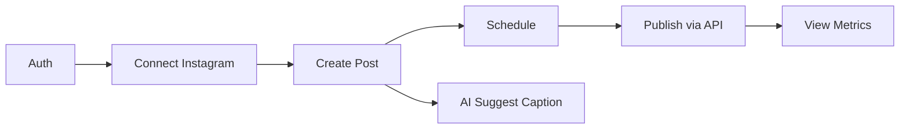

# Exploration: Tech Stack & Architecture — Social Media Manager

> Generated: 2026-06-25 | Phase: Explore
> Project: social-media-manager

---

## Current State

Greenfield project — no existing code. Three persona profiles (personal, collective, professional) each managing Instagram, TikTok, Facebook, X/Threads; collective also manages WhatsApp; professional also manages LinkedIn.

**Stack decisions already made:**
- Backend: Python + FastAPI
- Frontend: React (Next.js or Vite)
- Database: PostgreSQL via Supabase (free tier)
- AI Models: Hybrid — local (Ollama) first, cloud APIs later
- Multi-agent: CrewAI or custom Python agents

---

## 1. Project Structure

**Recommended: Monorepo with clear separation**

```
social-media-manager/
├── backend/
│   ├── app/
│   │   ├── api/              # FastAPI route modules
│   │   │   ├── auth.py
│   │   │   ├── profiles.py
│   │   │   ├── posts.py
│   │   │   ├── analytics.py
│   │   │   └── agents.py
│   │   ├── agents/           # Multi-agent system
│   │   │   ├── __init__.py
│   │   │   ├── orchestrator.py   # Main agent coordinator
│   │   │   ├── trend_researcher.py
│   │   │   ├── content_creator.py
│   │   │   ├── scheduler.py
│   │   │   ├── analytics_agent.py
│   │   │   └── whatsapp_bot.py
│   │   ├── core/
│   │   │   ├── config.py     # Pydantic Settings
│   │   │   ├── security.py   # Auth helpers
│   │   │   └── database.py   # Supabase/DB client
│   │   ├── models/           # Data models / SQLAlchemy
│   │   ├── schemas/          # Pydantic request/response schemas
│   │   └── main.py           # FastAPI app entry point
│   ├── tests/
│   ├── requirements.txt
│   └── alembic/              # DB migrations
├── frontend/
│   ├── app/                  # Next.js App Router pages
│   ├── components/           # Reusable React components
│   ├── lib/                  # API client, helpers
│   └── package.json
├── openspec/                 # SDD artifacts
├── .env.example
├── .gitignore
├── docker-compose.yml        # For local dev (PostgreSQL, Redis)
└── README.md
```

**Why this structure for a semi-junior:**
- Clear separation of concerns — backend and frontend are independent
- Agents live in their own module — easy to understand, test, and extend
- Flat `app/` layout (not deeply nested) — simpler to navigate
- You can run backend and frontend independently while learning

---

## 2. Agent Architecture — Approach Comparison

### Option A: CrewAI (Recommended to start)
- **How it works**: Define agents with roles, goals, and backstories. Define tasks with descriptions and expected outputs. CrewAI orchestrates execution.
- **Pros**: Declarative, good documentation, handles orchestration, easy to reason about
- **Cons**: Opinionated, may need customization for non-LLM tasks (API calls)
- **Learning curve**: Low-Medium
- **Best for**: Getting a working prototype fast

### Option B: Custom Python Agents (Recommended for MVP + learning)
- **How it works**: Each agent is a Python class with a `run()` method. An `Orchestrator` class calls them in sequence or based on events. Uses asyncio for concurrent execution.
- **Pros**: Full control, no framework lock-in, easier to debug, great for learning OOP + async patterns
- **Cons**: You build the orchestration logic yourself
- **Learning curve**: Medium (but teaches core concepts)
- **Best for**: Building understanding from first principles

### Option C: LangGraph
- **How it works**: Stateful graph-based agent workflows. Nodes are functions, edges define flow.
- **Pros**: Powerful for complex workflows, state management built-in
- **Cons**: Steeper learning curve, more abstract concepts (graphs, state machines)
- **Learning curve**: High
- **Best for**: After you've mastered Option A or B and need complex branching

### Recommendation: Start with a Hybrid

**Phase 1 — MVP**: Custom Python agents (Option B). Each agent is a simple class. An orchestrator runs them. This teaches you the fundamentals without framework magic.

**Phase 2 — Scale**: Introduce CrewAI for LLM-heavy agents (trend research, content creation) while keeping custom agents for API-heavy work (publishing, analytics fetch).

**Phase 3 — Mature**: Add LangGraph only if workflows become complex enough to need state machines.

### Agent Responsibilities

| Agent | Role | Tech |
|-------|------|------|
| **Orchestrator** | Coordinates all agents, manages scheduling, logs results | Custom Python |
| **Trend Researcher** | Scrapes/fetches trending topics per platform per profile | Custom + Ollama |
| **Content Creator** | Generates post ideas, scripts, captions, hashtags | CrewAI + Ollama |
| **Scheduler** | Manages post queue, publishes via platform APIs | Custom (APScheduler) |
| **Analytics Agent** | Fetches metrics, computes aggregates, generates reports | Custom |
| **WhatsApp Bot** | Manages community messages, auto-replies, broadcasts | Custom (Twilio/WhatsApp API) |

---

## 3. Database Schema (High-Level)

### Core Tables

```sql
-- Managed by Supabase Auth
users (
  id UUID PK,
  email TEXT,
  created_at TIMESTAMP
)

profiles (
  id UUID PK,
  user_id UUID FK → users,
  name TEXT,              -- "Personal", "Colectivo", "Profesional"
  slug TEXT,              -- "personal", "collective", "professional"
  avatar_url TEXT,
  created_at TIMESTAMP
)

social_accounts (
  id UUID PK,
  profile_id UUID FK → profiles,
  platform TEXT,          -- "instagram", "tiktok", "facebook", "x", "linkedin", "whatsapp"
  account_name TEXT,
  account_id TEXT,        -- Platform's user ID
  access_token TEXT ENCRYPTED,
  refresh_token TEXT ENCRYPTED,
  token_expires_at TIMESTAMP,
  is_active BOOLEAN DEFAULT true,
  created_at TIMESTAMP
)

content_posts (
  id UUID PK,
  profile_id UUID FK → profiles,
  platform TEXT,          -- Target platform (or "multi")
  title TEXT,
  body TEXT,              -- Post content / caption
  media_urls TEXT[],      -- Array of media URLs
  status TEXT,            -- "draft", "scheduled", "published", "failed"
  scheduled_for TIMESTAMP,
  published_at TIMESTAMP,
  platform_post_id TEXT,  -- ID from the platform after publishing
  created_by UUID FK → users,
  created_at TIMESTAMP,
  updated_at TIMESTAMP
)

content_ideas (
  id UUID PK,
  profile_id UUID FK → profiles,
  title TEXT,
  description TEXT,
  source TEXT,            -- "trend", "manual", "ai-generated"
  status TEXT,            -- "idea", "in-development", "converted"
  converted_to UUID FK → content_posts,
  created_at TIMESTAMP
)

schedules (
  id UUID PK,
  profile_id UUID FK → profiles,
  day_of_week INTEGER[],  -- 0=Sun, 1=Mon...
  time_of_day TIME,        -- Preferred posting time
  platform TEXT,
  is_active BOOLEAN DEFAULT true
)

metrics_snapshots (
  id UUID PK,
  social_account_id UUID FK → social_accounts,
  platform TEXT,
  metric_date DATE,
  followers INTEGER,
  following INTEGER,
  posts_count INTEGER,
  likes INTEGER,
  comments INTEGER,
  shares INTEGER,
  views INTEGER,
  engagement_rate FLOAT,
  data JSONB,              -- Platform-specific extra data
  collected_at TIMESTAMP
)

analytics_reports (
  id UUID PK,
  profile_id UUID FK → profiles,
  report_type TEXT,         -- "weekly", "monthly", "custom"
  period_start DATE,
  period_end DATE,
  summary TEXT,
  metrics JSONB,
  recommendations TEXT,
  created_at TIMESTAMP
)

-- Team collaboration (for collective profile)
team_members (
  id UUID PK,
  profile_id UUID FK → profiles,
  user_id UUID FK → users,
  role TEXT,                 -- "admin", "editor", "viewer"
  invited_at TIMESTAMP,
  joined_at TIMESTAMP
)

-- Future SaaS
subscription_tiers (
  id UUID PK,
  name TEXT,                 -- "free", "pro", "business"
  max_profiles INTEGER,
  max_accounts_per_profile INTEGER,
  has_analytics BOOLEAN,
  has_ai_content BOOLEAN,
  has_team BOOLEAN,
  price_monthly DECIMAL
)

user_subscriptions (
  id UUID PK,
  user_id UUID FK → users,
  tier_id UUID FK → subscription_tiers,
  status TEXT,               -- "active", "cancelled", "past_due"
  current_period_start TIMESTAMP,
  current_period_end TIMESTAMP
)
```

### Supabase-Specific Benefits
- **Row Level Security (RLS)**: Each user only sees their own data
- **Realtime subscriptions**: Push metrics updates to dashboard
- **Storage**: Store post media (images, videos)
- **Auth**: Built-in with social login support

---

## 4. Free Tier Sustainability Analysis

| Service | Free Tier | Limits | Sustainability |
|---------|-----------|--------|----------------|
| **Supabase** | 500MB DB, 5GB bandwidth, 50k MAU, 2GB storage | DB size may limit historical metrics; 500MB is ~500k rows | ✅ Fine for MVP with 1-3 users; upgrade needed for multi-tenant |
| **Vercel** | 100GB bandwidth, 6000 build min/month, SSL | Bandwidth fine for dashboard; build minutes can run out with frequent deploys | ✅ Great for frontend |
| **Render** | 750 hours/month (1 web service), 512MB RAM | Service sleeps after 15min idle (wakes on request) | ✅ Fine for MVP; cold start is ~5s |
| **PythonAnywhere** | 1 web app, 512MB storage, no custom domain | Limited Python environment; no async worker support easily | ⚠️ Limited for agent workloads |
| **Railway** | $5 credit one-time, then pay-as-you-go | Not truly free after credit runs out | ❌ Better for post-MVP |
| **GitHub Actions** | 2000 min/month free | Plenty for CI/CD | ✅ |
| **Ollama (local)** | Free, runs on your machine | Needs ~8GB RAM for 7B models, runs on CPU (slow) or GPU | ✅ For development |
| **Social Media APIs** | Free with rate limits | Instagram: 200 calls/hour; X: 500k posts/month free tier | ✅ For MVP with limited accounts |
| **Cloud AI APIs** | OpenAI: ~$0.15/1M tokens (GPT-4o-mini) Claude: similar | Very cheap for light usage | ✅ Use locally first, API when you have users |

### Recommendation
Run **everything locally** during development:
- **Backend**: `uvicorn` on localhost
- **Frontend**: `next dev` on localhost
- **Database**: Supabase cloud free tier OR local PostgreSQL
- **AI**: Ollama with Llama 3.1 8B or Mistral
- **Social APIs**: Dev accounts with API keys

Cost to start: **$0 per month**.

---

## 5. Learning Path — Semi-Junior Level

### Order of Learning (do NOT skip this order)

```
Week 1-2:  FastAPI fundamentals
  ├── Basic routes, path params, query params
  ├── Pydantic schemas for validation
  ├── Dependency injection
  └── Connect to Supabase DB

Week 3-4:  Supabase + Auth
  ├── Supabase client setup
  ├── User authentication (magic link / email)
  ├── Row Level Security policies
  └── CRUD operations

Week 5-6:  Next.js basics
  ├── Project setup (Vite is simpler; Next.js is industry standard)
  ├── Pages and routing
  ├── Fetching data from FastAPI backend
  └── Basic forms and state management

Week 7-8:  Integration
  ├── Connect frontend ↔ backend
  ├── User registration and login flow
  ├── Profile management
  └── Social account linking UI

Week 9-10: Agent System
  ├── Custom orchestrator class
  ├── Trend researcher agent (API calls)
  ├── Content creator (Ollama integration)
  └── Schedule/publish flow

Week 11-12: Analytics + Polish
  ├── Metrics fetching from platforms
  ├── Dashboard with charts (Chart.js or Recharts)
  └── Basic WhatsApp bot
```

### Recommended Resources
- **FastAPI**: Official tutorial (excellent docs) — https://fastapi.tiangolo.com/tutorial/
- **Supabase**: Quickstart guides — https://supabase.com/docs/guides/getting-started
- **Next.js**: Learn by doing — https://nextjs.org/learn
- **React**: Official tutorial — https://react.dev/learn
- **Ollama**: `ollama run llama3.1` — 5 minutes to a local LLM
- **CrewAI**: Official docs — https://docs.crewai.com/

### Common Pitfalls to Avoid
1. **Trying to learn everything at once** → Focus on ONE thing at a time (start with FastAPI alone)
2. **Over-engineering the agent system** → Start with simple classes, not frameworks
3. **Not using environment variables** → Use `.env` + Pydantic Settings from day one
4. **Forgetting async/await** → FastAPI uses async; practice async Python before starting
5. **Hardcoding social media tokens** → Use an encrypted column or Supabase Vault
6. **Skipping error handling** → Social media APIs fail often; build retry logic early
7. **Building for scale before you have users** → Premature optimization kills velocity

---

## 6. MVP Scope (Minimum Viable Product)

### MVP = One profile (Personal), One platform (Instagram), One flow



### What MVP includes:
- ✅ User registration (Supabase Auth)
- ✅ Create a "Personal" profile
- ✅ Connect Instagram business account
- ✅ Create post drafts with rich text
- ✅ AI-generated caption suggestions (Ollama)
- ✅ Schedule posts
- ✅ Publish to Instagram (via Graph API)
- ✅ Basic metrics dashboard (likes, comments, reach)
- ✅ Simple calendar view

### What MVP explicitly excludes:
- ❌ Multi-profile management
- ❌ TikTok, Facebook, X, LinkedIn, WhatsApp integrations
- ❌ Team collaboration
- ❌ Advanced analytics (trends, recommendations)
- ❌ SaaS billing

This MVP is achievable in ~6-8 weeks working part-time.

---

## Recommendations Summary

| Area | Recommendation |
|------|---------------|
| **Project structure** | Flat monorepo: `backend/` + `frontend/` + `openspec/` |
| **Agent framework** | Custom Python classes for MVP; add CrewAI later |
| **Database** | Supabase (free tier) with RLS for security |
| **Local AI** | Ollama + Llama 3.1 8B or Mistral |
| **Hosting (dev)** | All local: `uvicorn` + `next dev` |
| **First platform** | Instagram only (most feature-rich API for content) |
| **Learning order** | FastAPI → Supabase → Next.js → Agents → Analytics |

---

## Risks

1. **Social media API complexity**: Instagram/TikTok APIs have strict requirements (business accounts, app review, permission scopes). Mitigation: Start with Instagram (most documented), validate API access early.
2. **Ollama quality on CPU**: Local 7B models on CPU are slow (2-5 tokens/second) and quality varies. Mitigation: Start with smaller models (Mistral 7B, Llama 3.1 8B), upgrade to API if needed.
3. **Token storage security**: Social media tokens give access to accounts. Mitigation: Encrypt at rest using Supabase Vault or `cryptography` library.
4. **Scope creep**: "Let me just add one more platform..." Mitigation: Strict MVP scope. Instagram only until it works end-to-end.

---

## Ready for Proposal

**Yes**. This exploration provides enough architectural foundation to write a formal proposal (PRD) for the MVP. The key decisions are documented: tech stack, project structure, agent architecture, data model, learning path, and MVP scope.

Next phase: **Proposal** — formalize the change as `sdd/{change-name}/proposal`.
